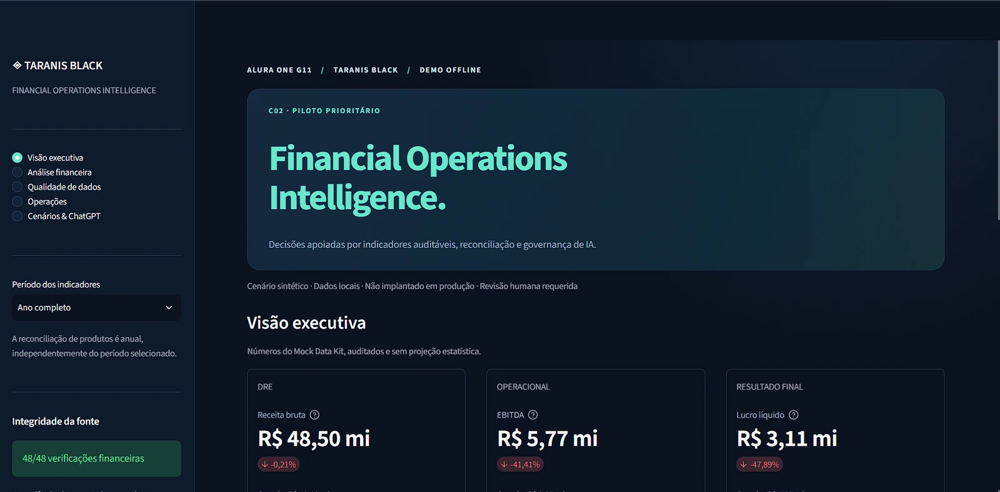
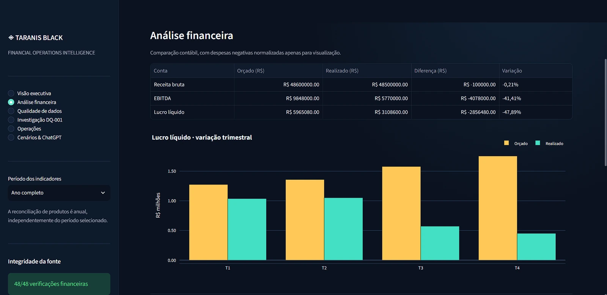
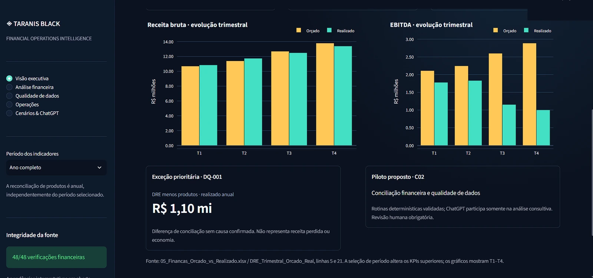
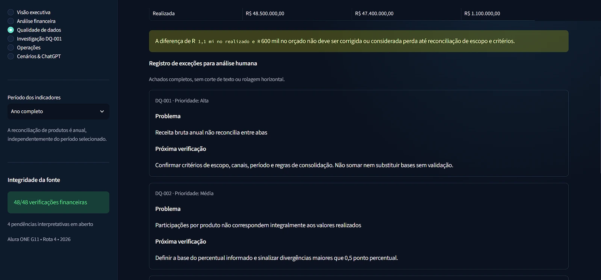
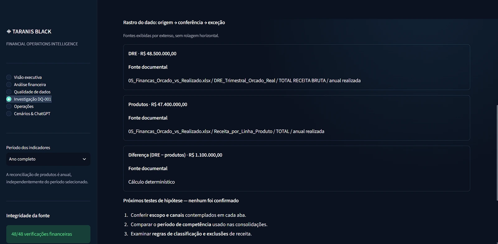
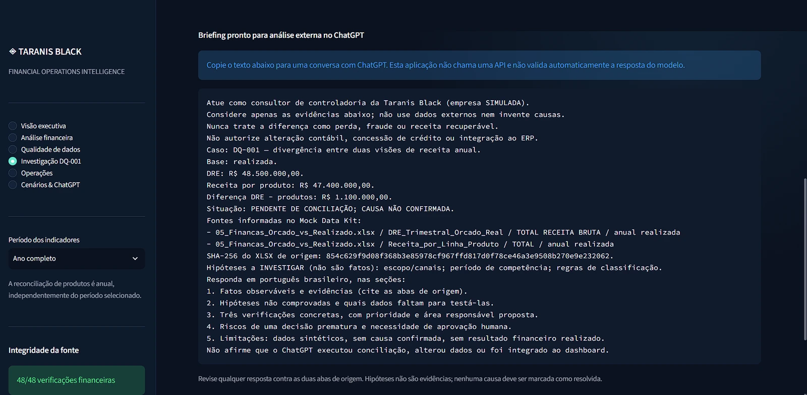
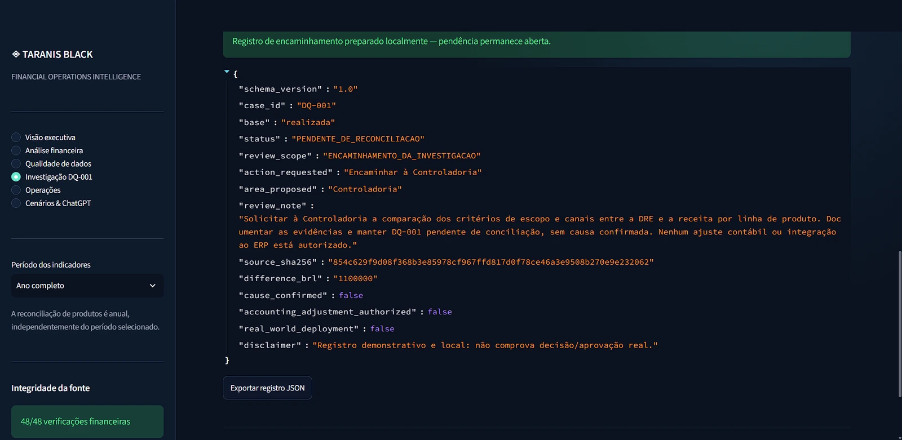
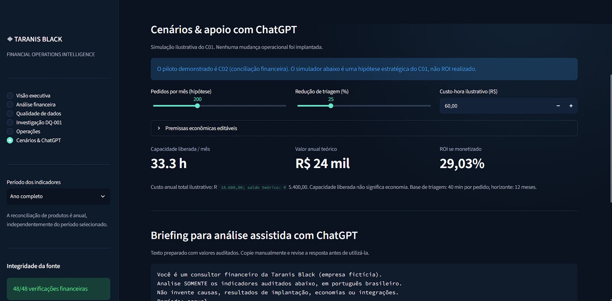
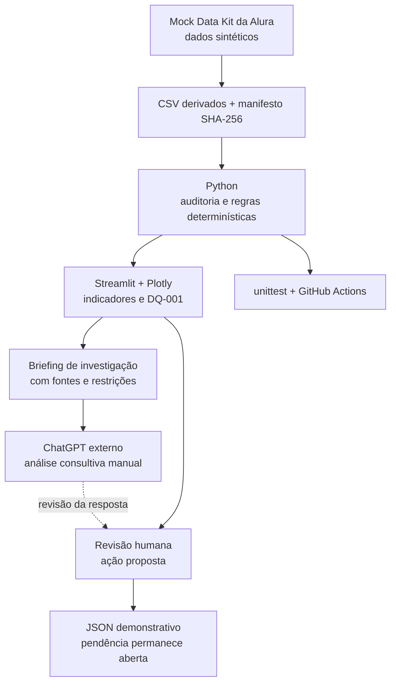
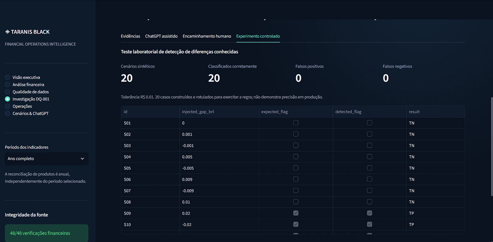

<a id="inicio"></a>

# 🛡️ Taranis Black — Financial Operations Intelligence

**Da inconsistência financeira à decisão responsável: dados auditáveis, investigação assistida por IA e supervisão humana.**

[](https://github.com/brodyandre/financial-operations-ai-analytics/actions/workflows/quality.yml)
&nbsp; `Python 3.12` · `Streamlit` · `Plotly` · `unittest` · `GitHub Actions` · `ChatGPT (uso externo)`

**Challenge ONE G11 — AI for Business · Alura**

**Escopo:** Rota 0 (estratégia e governança) + Rota 4 (finanças, processos e operações).

**Natureza:** projeto educacional, empresa e dados **simulados**; protótipo local, sem integração a sistemas produtivos.

> **Uma diferença entre relatórios não é, por si só, uma perda. Uma hipótese não é uma causa comprovada. E uma sugestão de IA não é uma aprovação humana.**

<p align="center">
  
</p>

<p align="center"><sub>📸 Interface real do protótipo, capturada em ambiente local com dados sintéticos da Alura.</sub></p>

### 🔎 Navegue pelo projeto

| Entenda o negócio | Explore a solução | Verifique a engenharia |
|:--|:--|:--|
| [🎯 O desafio](#desafio) | [💡 Nossa proposta](#solucao) | [🏗️ Arquitetura](#arquitetura) |
| [📊 Evidências financeiras](#diagnostico) | [🧭 Rota 0 e Rota 4](#rotas) | [🧪 Testes e experimento](#validacao) |
| [🕵️ Caso DQ-001](#dq001) | [🖥️ Telas e demonstração](#telas) | [🚀 Executar localmente](#executar) |
| [🛡️ IA responsável](#governanca) | [📚 Documentação](#documentacao) | [⚠️ Limites e próximos passos](#limites) |

---

<a id="desafio"></a>
## 🎯 1. O desafio de negócio proposto pela Alura

A **Taranis Black** é uma empresa **B2B fictícia**, especializada em soluções de ergonomia e ambientes corporativos. O cenário do challenge apresenta um negócio com aproximadamente **R$ 48 milhões de faturamento anual**, **280 colaboradores** e **crescimento de 35%** — mas com processos manuais e informações distribuídas entre áreas.

Esse crescimento expõe problemas concretos: aprovações por e-mail, consultas a planilhas e sistemas distintos, retrabalho entre Comercial, Financeiro e Logística, atrasos de fechamento e divergências entre relatórios financeiros.

**Exemplos extraídos do Mock Data Kit da Alura:**

| Indicador do cenário simulado | Situação informada | Meta de referência |
|:--|--:|--:|
| Fechamento contábil | **7 dias úteis** | 2 dias úteis |
| Homologação de crédito B2B | **48 horas** | Até 4 horas |
| Reentregas e fretes emergenciais | **2,8% do faturamento** | 0,8% |
| Triagem manual de proposta | **40 minutos por pedido** | Redução a ser validada em piloto |

A pergunta central não é simplesmente *“como colocar IA em um dashboard?”* É:

> **Como apoiar decisões financeiras e operacionais com dados confiáveis, evidências rastreáveis e IA generativa — sem automatizar decisões de alto risco nem inventar resultados?**

O enunciado orienta a construção de uma visão estratégica de IA (**Rota 0**) e o aprofundamento em **Finanças e Operações (Rota 4)**. Este repositório reúne tanto os entregáveis consultivos quanto um protótipo funcional adicional.

[⬆️ Voltar ao início](#inicio)

---

<a id="diagnostico"></a>
## 📊 2. O que encontramos nos dados

A análise da planilha `05_Financas_Orcado_vs_Realizado.xlsx` revela diferenças entre orçamento e realizado, além de um problema de qualidade de dados que merece investigação própria.

| Indicador anual | Orçado | Realizado | Interpretação |
|:--|--:|--:|:--|
| **Receita bruta — DRE** | R$ 48,60 mi | **R$ 48,50 mi** | Quase alinhada ao orçamento |
| **EBITDA** | R$ 9,848 mi | **R$ 5,77 mi** | 41,41% abaixo do orçado |
| **Lucro líquido** | R$ 5,965 mi | **R$ 3,109 mi** | Abaixo do orçamento |
| **Despesa de fretes** | R$ 2,38 mi | **R$ 3,74 mi** | Desvio desfavorável de R$ 1,36 mi |

**Mas o achado principal é outro:**

| Visão de receita anual realizada | Total |
|:--|--:|
| Demonstrativo de Resultados (DRE) | **R$ 48.500.000,00** |
| Receita consolidada por linha de produto | **R$ 47.400.000,00** |
| **Diferença a investigar (DQ-001)** | **R$ 1.100.000,00** |

**⚠️ Atenção:** os R$ 1,1 milhão **não são** perda identificada, fraude, economia ou receita recuperável. A diferença é aritmética; sua causa permanece **não confirmada**. Antes de conciliá-la, é necessário verificar escopo, competência e critérios de classificação nas fontes.

A análise também evita somar impactos operacionais estimados com despesas da DRE sem investigar possíveis sobreposições.

<a id="tela-analise-financeira"></a>
### 📉 Análise financeira — o que o orçamento previa e o que ocorreu

A página **Análise financeira** coloca receita, EBITDA e lucro líquido lado a lado com seus valores orçados. O gráfico de lucro líquido destaca o desvio trimestral, especialmente no segundo semestre da série sintética.

[](evidence/screenshots/08-analise-financeira.webp)

*📸 Análise financeira — indicadores anuais e evolução trimestral do lucro líquido. Clique para ampliar.*

<a id="tela-graficos-trimestrais"></a>
### 📊 Evolução trimestral — receita e EBITDA

A **Visão executiva** permite comparar os quatro trimestres: **Orçado (âmbar)** versus **Realizado (verde-água)**. Os gráficos complementam a tabela anual e deixam claro por que a receita quase alinhada ao orçamento não significa EBITDA também alinhado.

[](evidence/screenshots/02-graficos-trimestrais.webp)

*📸 Comparação trimestral de receita e EBITDA. Clique para ampliar.*

<a id="tela-qualidade-dados"></a>
### 🧾 Qualidade de dados — quatro exceções que exigem leitura humana

A seção **Qualidade de dados** apresenta cada achado com sua **prioridade, problema e próxima verificação**, em cartões que evitam textos truncados. Além da DQ-001, documenta divergências percentuais, possíveis sobreposições de custos e a limitação do histórico para predições.

[](evidence/screenshots/03-qualidade-de-dados.webp)

*📸 Registro de exceções e próximos testes propostos. Nenhuma hipótese é uma causa comprovada.*

[⬆️ Voltar ao início](#inicio)

---

<a id="solucao"></a>
## 💡 3. A proposta desenvolvida

Em vez de prometer uma automação total, adotamos um desenho em **três camadas complementares**:

1. **Confiar nos cálculos, não em palpites:** Python lê os dados derivados do kit, reproduz métricas e executa regras determinísticas de consistência.
2. **Tornar a análise compreensível:** o dashboard reúne indicadores, desvios, exceções e cenários explicitamente hipotéticos, sempre com suas fontes.
3. **Usar IA com responsabilidade:** o ChatGPT recebe um **briefing estruturado por cópia manual**, produz sugestões de investigação e a pessoa responsável decide os próximos passos. O registro pode ser exportado em JSON, mas **não aprova** ajustes ou altera um ERP.

**O protótipo recebe o nome _Financial Operations Intelligence_.** Sua funcionalidade central é a **Investigação DQ-001**, que percorre a sequência *evidência → análise consultiva → encaminhamento humano → registro demonstrativo*.

**O que já funciona nesta demonstração:**

- ✅ Dashboard Streamlit com seis áreas de navegação, incluindo **Investigação DQ-001**.
- ✅ Comparação entre orçamento e realizado, qualidade de dados e riscos financeiros.
- ✅ Investigação documental com SHA-256 informado da planilha de origem.
- ✅ Briefing para ChatGPT sem API, token, envio automático ou resposta integrada.
- ✅ Formulário de encaminhamento **simulado**, com status pendente e exportação JSON.
- ✅ Experimento de regras determinísticas com **20 casos sintéticos rotulados**.
- ✅ Testes automatizados e pipeline de CI no GitHub Actions.

[⬆️ Voltar ao início](#inicio)

---

<a id="dq001"></a>
## 🕵️ 4. DQ-001 — da divergência à ação investigativa

**DQ-001** é a demonstração de ponta a ponta que melhor explica o valor do projeto.

### Etapa A — A evidência é rastreável

O usuário seleciona a base **Realizada** ou **Orçada** e acessa valores, abas de origem, operação aritmética e possíveis verificações — sem marcar hipóteses como causas.

<a id="tela-evidencias-dq001"></a>

[](evidence/screenshots/04-evidencias-dq001.webp)

*📸 A origem dos R$ 48,50 mi, R$ 47,40 mi e da diferença de R$ 1,10 mi pode ser inspecionada por extenso. Clique para ampliar.*

### Etapa B — O ChatGPT auxilia a interpretação

A aplicação gera um prompt que instrui o modelo a distinguir fatos e hipóteses, propor três verificações concretas, explicitar riscos e **não autorizar mudanças contábeis, crédito ou integração ao ERP**.

<a id="tela-chatgpt-assistido"></a>

[](evidence/screenshots/05-briefing-chatgpt.webp)

*📸 Briefing estruturado para análise consultiva. Clique para ampliar.*

**Importante:** a análise ocorre em uma conversa externa no ChatGPT, iniciada manualmente. **Não existe API de IA integrada ao Streamlit**; as respostas não são automaticamente validadas ou importadas para o dashboard.

### Etapa C — A pessoa continua responsável

O parecer consultivo gera uma **proposta de investigação**. Um formulário permite escolher a área responsável, registrar uma observação e exportar o encaminhamento em JSON. O estado da exceção continua **`PENDENTE_DE_RECONCILIACAO`**.

<a id="tela-encaminhamento-humano"></a>

[](evidence/screenshots/06-encaminhamento-json.webp)

*📸 Registro JSON demonstrativo exportável, com `cause_confirmed: false` e `accounting_adjustment_authorized: false`. Clique para ampliar.*

**Nenhum lançamento, ajuste financeiro, aprovação de crédito ou disparo de fluxo corporativo foi executado.**

[⬆️ Voltar ao início](#inicio)

---

<a id="rotas"></a>
## 🧭 5. Como a solução atende ao challenge

### Rota 0 — Estratégia, priorização e governança (obrigatória)

Foram documentados o **AI Canvas**, três casos de uso, uma **matriz Esforço × Impacto**, indicadores e cenários de ROI **hipotéticos**, plano de gestão da mudança e propostas de política de IA, LGPD e supervisão humana.

| Oportunidade | Impacto / 5 | Esforço / 5 | Decisão no protótipo |
|:--|--:|--:|:--|
| **C02 — Conciliação e qualidade financeira** | **4,40** | **2,00** | **Piloto demonstrativo priorizado** |
| **C01 — Pré-triagem de pedidos B2B** | 4,35 | 3,35 | Proposta condicionada; cenários apenas ilustrativos |
| **C03 — Predição de risco logístico** | 3,75 | 4,70 | Não implementada: histórico insuficiente |

Essas notas são **avaliações consultivas ponderadas**, não ganhos medidos ou uma análise de implantação real.

<a id="tela-cenarios-c01"></a>
#### 🎚️ C01 — Simulador de cenários e análise assistida

A tela **Cenários & ChatGPT** permite alterar o volume hipotético de pedidos, a redução de tempo de triagem e o custo-hora. Com as premissas exibidas na captura, o modelo ilustra **33,3 horas/mês de capacidade liberada** e **29,03% de ROI somente se essa capacidade for monetizada**. Isso **não é economia efetiva**: o piloto desenvolvido é **C02**, e o C01 segue como oportunidade estratégica.

[](evidence/screenshots/09-cenarios-chatgpt.webp)

*📸 Simulação editável do C01 — resultados condicionais, sem implantação operacional. Clique para ampliar.*

📎 [AI Canvas](docs/rota0/01_AI_CANVAS_TARANIS_BLACK.md) · [Matriz Esforço × Impacto](docs/rota0/05_PRIORIZACAO_ESFORCO_IMPACTO.md) · [Política de IA e LGPD](docs/rota0/10_POLITICA_USO_IA_LGPD.md)

### Rota 4 — Finanças, Processos e Operações

O diagnóstico mapeia o processo de pedido B2B em **cinco etapas AS-IS**, documenta a matriz **SIPOC**, organiza hipóteses pelo **Ishikawa 6M** e propõe melhorias **TO-BE**, sem alegar implantação.

📎 [Diagnóstico Lean](docs/rota4/01_DIAGNOSTICO_LEAN_EXECUTIVO.md) · [Fluxos AS-IS/TO-BE](docs/rota4/02_FLUXOS_AS_IS_TO_BE.md) · [Matriz SIPOC](docs/rota4/03_MATRIZ_SIPOC.md) · [Ishikawa 6M](docs/rota4/04_ISHIKAWA_6M.md) · [Guia do dashboard](docs/rota4/07_DASHBOARD_GUIA.md)

[⬆️ Voltar ao início](#inicio)

---

<a id="arquitetura"></a>
## 🏗️ 6. Arquitetura — simples, verificável e sem dependência de cloud



| Componente | Papel real |
|:--|:--|
| **Python 3.12** | Leitura de dados derivados, cálculos, regras financeiras e investigação |
| **Streamlit** | Interface interativa e formulários demonstrativos |
| **Pandas + Plotly** | Organização de indicadores e gráficos |
| **ChatGPT** | Interpretação consultiva **fora do aplicativo**, sem API |
| **unittest + GitHub Actions** | Regressão e reprodução dos controles |
| **CSV + JSON** | Fontes preparadas, manifesto e exportações locais |

Não utilizamos banco de produção, credenciais corporativas, serviços cloud, integração ao ERP ou modelos preditivos treinados.

[⬆️ Voltar ao início](#inicio)

---

<a id="telas"></a>
## 🖥️ 7. Índice visual — explore cada tela no seu contexto

As **nove capturas reais** estão distribuídas pelas explicações do projeto, e não reunidas em uma galeria isolada. Clique no tema para ir ao **trecho do README que explica a tela**; em cada trecho, a imagem também é clicável para ampliação.

| Tela / evidência | Onde a imagem aparece | O que ela demonstra |
|:--|:--|:--|
| 🧭 Visão executiva | [Apresentação do projeto](#inicio) | Identidade visual e três KPIs principais |
| 📉 Análise financeira | [Diagnóstico financeiro](#tela-analise-financeira) | Orçado × realizado e lucro líquido trimestral |
| 📊 Gráficos de receita e EBITDA | [Evolução trimestral](#tela-graficos-trimestrais) | Desvios entre os trimestres |
| 🧾 Qualidade de dados | [Registro de exceções](#tela-qualidade-dados) | Problemas e próximas verificações completas |
| 🔎 DQ-001 — Evidências | [Investigação, etapa A](#tela-evidencias-dq001) | Fontes documentais e diferença aritmética |
| 🤖 ChatGPT assistido | [Investigação, etapa B](#tela-chatgpt-assistido) | Briefing consultivo estruturado |
| 🛡️ Encaminhamento humano | [Investigação, etapa C](#tela-encaminhamento-humano) | Registro JSON com pendência preservada |
| 🎚️ Cenários & ChatGPT | [Simulação C01](#tela-cenarios-c01) | Premissas e ROI estritamente hipotético |
| 🧪 Experimento controlado | [Validação do protótipo](#tela-experimento-controlado) | 20 classificações em casos sintéticos |

**Nota sobre o histórico visual:** a imagem de abertura e os gráficos de receita/EBITDA representam uma versão anterior da navegação, antes da inclusão da seção DQ-001. Os cálculos mostrados seguem os mesmos valores do Mock Data Kit.

**🎬 Vídeo de demonstração:** em preparação; o roteiro está em [docs/showme/03_ROTEIRO_VIDEO.md](docs/showme/03_ROTEIRO_VIDEO.md). O link será incluído **após** sua publicação.

[⬆️ Voltar ao início](#inicio)

---

<a id="validacao"></a>
## 🧪 8. O que foi testado — e o que os testes não provam

A auditoria determinística preserva **48 verificações de consistência** e registra exceções documentais sem apagá-las. O projeto inclui testes unitários e [CI no GitHub Actions](https://github.com/brodyandre/financial-operations-ai-analytics/actions/workflows/quality.yml).

O experimento demonstrativo da DQ-001 usa **20 casos sintéticos construídos e rotulados para exercitar a regra** de detecção de diferenças, com tolerância de **R$ 0,01**:

| Resultado no conjunto sintético | Quantidade |
|:--|--:|
| Verdadeiros positivos — diferenças corretamente sinalizadas | 12 |
| Verdadeiros negativos — situações corretamente não sinalizadas | 8 |
| Falsos positivos | 0 |
| Falsos negativos | 0 |
| **Casos classificados corretamente** | **20 de 20** |

<a id="tela-experimento-controlado"></a>

[](evidence/screenshots/07-experimento-controlado.webp)

*📸 Métricas e parte dos casos rotulados para exercitar a regra determinística. Clique para ampliar.*

> **Limitação essencial:** 20/20 é o resultado **deste experimento sintético controlado**. Não mede acurácia de IA, precisão em dados reais, redução de tempo, economia, capacidade de produção ou desempenho em ambiente empresarial.

📎 [Metodologia do experimento](docs/showme/02_EXPERIMENTO_METODOLOGIA.md) · [Testes do caso DQ-001](tests/test_showme.py) · [Código do experimento](src/taranis_black/dq_experiment.py)

[⬆️ Voltar ao início](#inicio)

---

<a id="governanca"></a>
## 🛡️ 9. IA responsável e controle humano

Nossa regra de implementação é clara: **a IA pode apoiar a compreensão do problema, mas não recebe autoridade para resolvê-lo sozinha**.

- **Fatos versus hipóteses:** as causas sugeridas são verificações a executar, não conclusões.
- **Rastreabilidade:** valores, nomes de abas, operação de cálculo e hash informado são exibidos.
- **Privacidade:** somente dados sintéticos; sem envio de informações pessoais ou credenciais.
- **Revisão humana:** recomendações e registros demonstrativos não substituem aprovação formal.
- **Sem efeitos colaterais corporativos:** nenhuma alteração de lançamento, crédito ou ERP.
- **Transparência:** o texto do modelo é obtido externamente e **não é validado automaticamente pelo dashboard**.

As políticas e controles corporativos descritos no projeto são **propostas educacionais**, não políticas adotadas por uma empresa real.

📎 [Política de uso de IA](docs/rota0/10_POLITICA_USO_IA_LGPD.md) · [Matriz de riscos](docs/rota0/11_RISCOS_CONTROLES_VIES.md) · [Comitê e responsabilidades propostas](docs/rota0/12_COMITE_AUDITORIA_RACI.md)

[⬆️ Voltar ao início](#inicio)

---

<a id="executar"></a>
## 🚀 10. Como executar localmente

**Pré-requisitos:** Python 3.12, Git e terminal (Windows com WSL2/Ubuntu é um ambiente testado). A interface usa dependências locais e **não precisa de chave de API**.

```bash
# 1. Clonar o repositório
git clone https://github.com/brodyandre/financial-operations-ai-analytics.git
cd financial-operations-ai-analytics

# 2. Criar e ativar ambiente virtual
python3 -m venv .venv
source .venv/bin/activate

# 3. Instalar a interface
python -m pip install -r requirements-dashboard.txt

# 4. Testar
python -m unittest discover -s tests -v
python scripts/check_dashboard.py
python scripts/check_showme.py
bash scripts/check_project.sh

# 5. Iniciar o dashboard
python -m streamlit run dashboard/app.py --server.address 127.0.0.1
```

Acesse o endereço local exibido pelo Streamlit (em geral **http://127.0.0.1:8501**); a porta pode mudar se outra instância estiver ativa. Encerre com `Ctrl+C`.

**Observações de reprodutibilidade:** o XLSX original é mantido **fora do repositório** em `data/source/`. Os CSVs derivados e o manifesto permitem reproduzir a demonstração baseada no snapshot publicado; para **revalidar o hash contra o arquivo original**, é necessário obter legitimamente o Mock Data Kit da Alura e colocar o XLSX no caminho documentado. Alguns testes/rotinas podem exigir o conjunto de arquivos do projeto atualizado; se algo falhar, consulte o [guia do dashboard](docs/rota4/07_DASHBOARD_GUIA.md) e o [guia da investigação](docs/showme/00_INSTALACAO_E_VALIDACAO.md).

[⬆️ Voltar ao início](#inicio)

---

<a id="documentacao"></a>
## 📚 11. Documentação e evidências

| Tema | Onde encontrar |
|:--|:--|
| Plano, escopo e requisitos | [docs/00_PLANO_EXECUCAO.md](docs/00_PLANO_EXECUCAO.md) · [Mapa de requisitos](docs/01_MAPA_REQUISITOS_E_EVIDENCIAS.md) |
| Estratégia, casos de IA e KPIs | [docs/rota0/](docs/rota0/) |
| Processo Lean, SIPOC e Ishikawa | [docs/rota4/](docs/rota4/) |
| Investigação financeira DQ-001 | [Proposta](docs/showme/01_PROPOSTA_DQ001.md) · [Roteiro](docs/showme/03_ROTEIRO_VIDEO.md) |
| Código analítico | [src/taranis_black/](src/taranis_black/) |
| Dashboard e tema visual | [dashboard/app.py](dashboard/app.py) · [dashboard/theme.css](dashboard/theme.css) |
| Testes e verificações | [tests/](tests/) · [scripts/](scripts/) |
| Capturas de tela | [evidence/screenshots/](evidence/screenshots/) |

**Fonte do desafio:** Mock Data Kit **Taranis Black — ONE AI for Business G11**, fornecido pela Alura. Os originais permanecem locais, preservando a separação entre materiais do desafio e código publicado.

[⬆️ Voltar ao início](#inicio)

---

<a id="limites"></a>
## ⚠️ 12. Limitações, próximos passos e entrega

**Este é um protótipo educacional — não um sistema financeiro produtivo.** Não houve integração corporativa, conciliação concluída, ganho financeiro realizado ou validação em dados reais. As simulações de ROI para outros casos de uso são **hipóteses com premissas**, não resultados alcançados.

**Próximos marcos:** validar a suíte após o último ajuste visual, gravar a demonstração e preencher o **Google Docs oficial da Alura**, que será a peça de submissão exigida no challenge. O repositório e o vídeo serão evidências complementares.

**Prazo informado para o challenge:** **08/11/2026** · **Congelamento técnico planejado:** 06/11/2026.

---

**Projeto desenvolvido para fins de aprendizagem e demonstração profissional.**

Repositório: [github.com/brodyandre/financial-operations-ai-analytics](https://github.com/brodyandre/financial-operations-ai-analytics) · Perfil: [@brodyandre](https://github.com/brodyandre)

<p align="center"><a href="#inicio">⬆️ Voltar ao topo</a></p>
