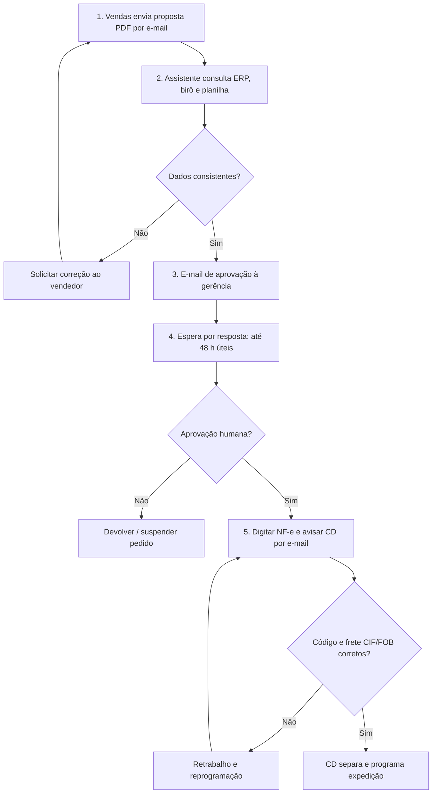
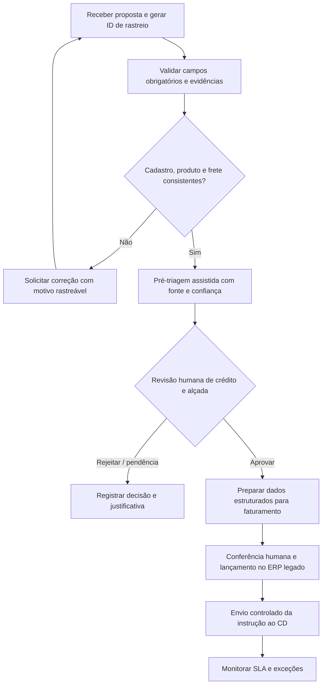

# Fluxos — AS-IS e TO-BE (proposta)

**Fonte AS-IS:** `06_Descritivo_Processo_Operacional_SIPOC.docx`, seção "O FLUXO ATUAL PASSO A PASSO", passos 1 a 5. **TO-BE:** proposta consultiva, ainda não implantada.

## AS-IS: cinco passos manuais

**Fluxo observado:** 40 minutos por proposta na triagem manual (passo 2), 24–48 horas úteis de espera por aprovação (passo 4), ciclo total superior a cinco dias úteis; meta diretiva do ciclo: até 24 horas úteis.

## TO-BE: desenho de melhoria sob avaliação

**Restrições de implementação:** o ERP é descrito como **sem API**. Este TO-BE não afirma automação do lançamento, integração implantada, aprovação automática de crédito ou IA em produção. Para a demo, podemos simular entradas e apresentar validações locais auditáveis; nenhum cliente real é processado.

## Pontos de controle

| Gate | Regra proposta | Responsável proposto | Evidência desejada |
|---|---|---|---|
| Entrada | Campos essenciais completos e consistentes | Comercial / Financeiro | Checklist por pedido |
| Crédito | Alçada e decisão revisadas por pessoa autorizada | Gerente financeiro | Decisão e justificativa |
| Faturamento | Divergência de item, preço e frete bloqueia liberação | Faturamento | Registro de exceção |
| Expedição | Confirmação de dados e instrução ao CD | Expedição | Status e data/hora |

*O modelo AS-IS foi reconstruído do texto oficial; o TO-BE é hipótese de redesign a validar com negócio/TI/jurídico antes de eventual implantação.*
