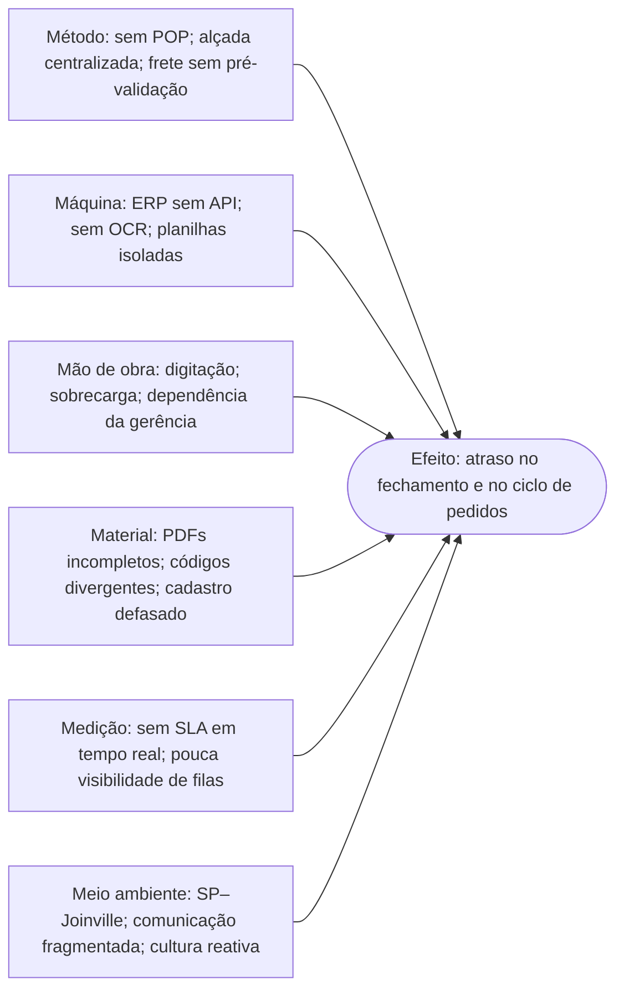

# Diagrama de Ishikawa — 6M

**Efeito central:** atraso de **cinco dias no fechamento contábil mensal** e ciclo de faturamento/expedição **superior a cinco dias úteis**. São dois indicadores relacionados, mas distintos. Categorias baseadas no `06_Descritivo_Processo_Operacional_SIPOC.docx`, seção "Base de Causas Raízes".

## Evidências e hipóteses de causa

| Categoria 6M | Evidência registrada no dossiê | Tratamento proposto | Classificação |
|---|---|---|---|
| Método | Ausência de POP, alçadas uniformes e checagem de CIF/FOB | POP, regras de exceção e checklist | Causa relatada + melhoria hipotética |
| Máquina | ERP sem API, inexistência de OCR, três planilhas locais | Pré-triagem local + camada de validação, sem prometer integração | Causa relatada + melhoria hipotética |
| Mão de obra | Digitação manual e concentração de aprovações | Redesenho de papéis e revisão humana focada em exceções | Causa relatada + melhoria hipotética |
| Material | PDFs incompletos, divergências de código e cadastros | Padrão de proposta e campos obrigatórios | Causa relatada + melhoria hipotética |
| Medição | Ausência de SLA em tempo real e fila por departamento | KPIs com carimbo de data/hora e rastreabilidade | Causa relatada + melhoria hipotética |
| Meio ambiente | Distância SP/Joinville, comunicação reativa | Protocolo unificado e acordos de resposta | Causa relatada + melhoria hipotética |

**Limite:** a fonte apresenta essas evidências como causas identificadas em auditorias internas do cenário sintético. Não há análise estatística de contribuição individual; não é possível afirmar que uma categoria é responsável por determinada porcentagem dos atrasos.
